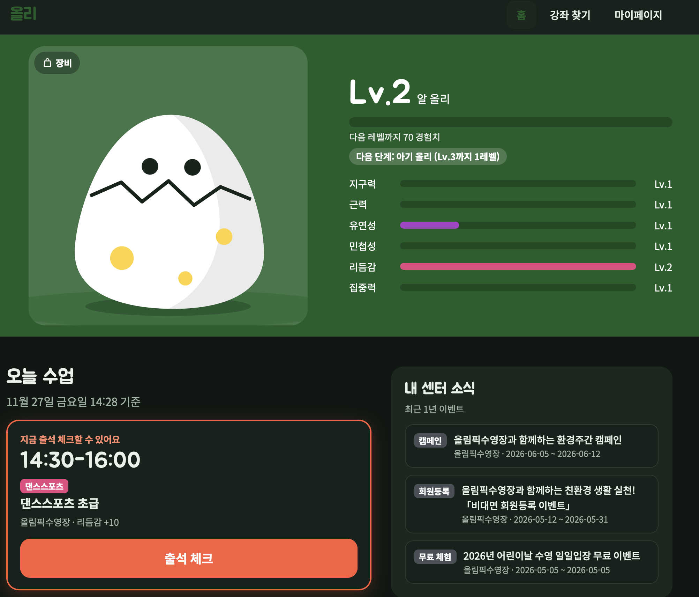
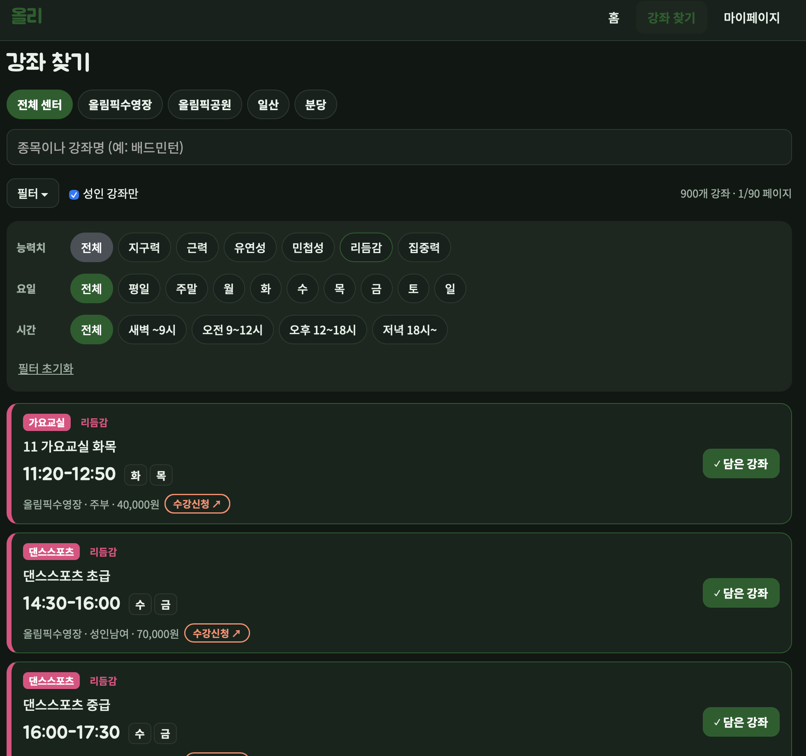
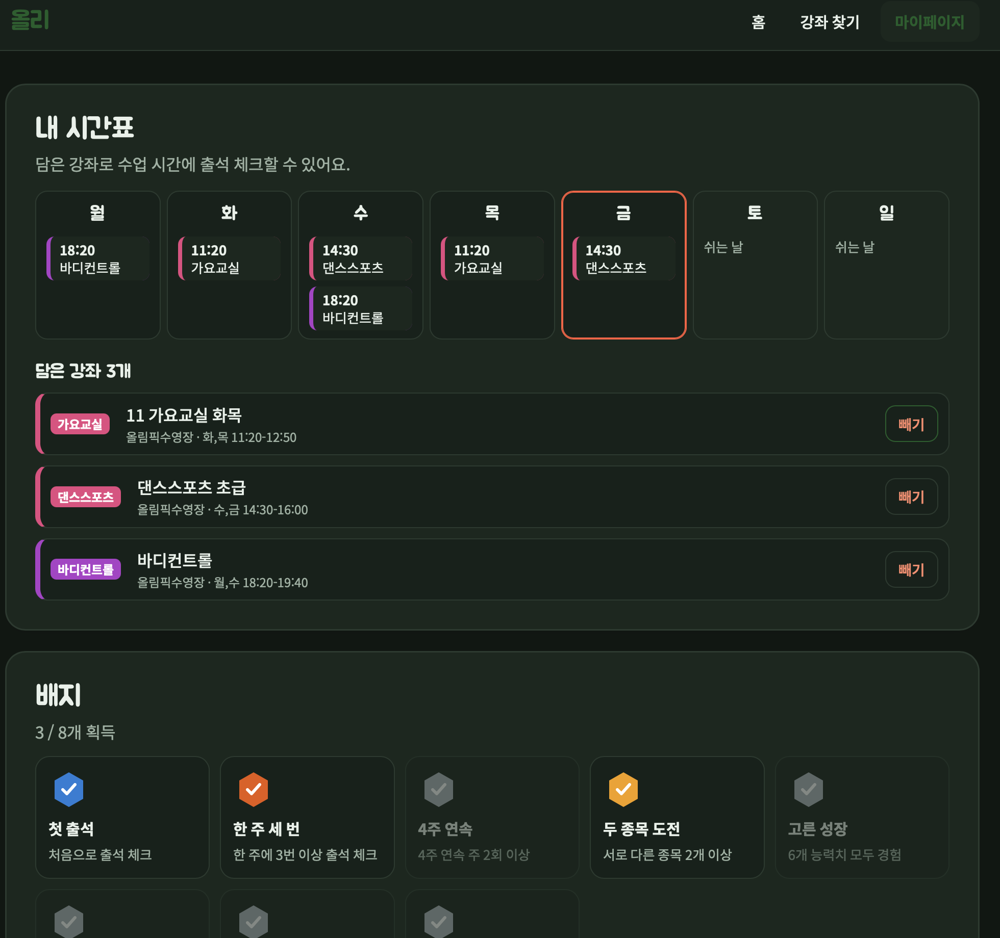
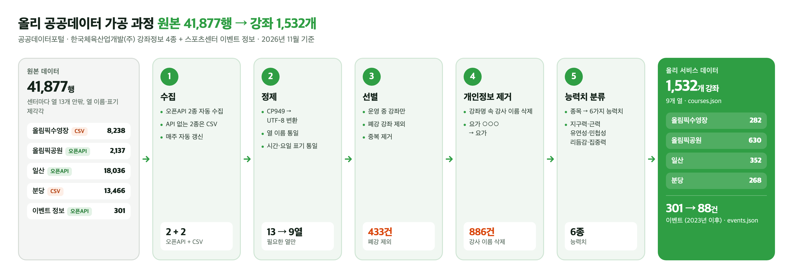

# 올리 (Olly)

> **오늘 한 번의 출석이 내일의 체력이 됩니다.**

공공 스포츠센터 수업에 출석할 때마다 운동 친구 '올리'가 자라는 웹 서비스입니다.
운동을 새로 시작하는 사람은 부담 없이 첫걸음을 떼고, 이미 다니는 사람은 꾸준히 이어갈 수 있도록 돕습니다.

- **서비스 주소**: [올리](https://niceome.github.io/olly/)
- 2026년도 한국체육산업개발(주) 공공데이터 활용 경진대회 출품작
- 한국체육산업개발(주)의 공식 서비스가 아닙니다.

<table>
  <tr><th colspan="2">홈</th></tr>
  <tr><td colspan="2"></td></tr>
  <tr><th width="50%">강좌 찾기</th><th width="50%">마이페이지</th></tr>
  <tr>
    <td width="50%"></td>
    <td width="50%"></td>
  </tr>
</table>

---

## 문제 정의

| 문제 | 근거 |
|---|---|
| 운동할 마음은 있지만 꾸준히 이어가기 어렵다 | 체육활동에 참여하지 않는 이유 2위 '관심 부족' 51.2%, 전년보다 증가 (문체부, 2025 국민생활체육조사) |
| 기관의 동기부여 이벤트는 기간이 끝나면 사라진다 | 헬스 3개 미션, 100일 챌린지, 회원등록 이벤트 등 일회성 운영 (기관 이벤트 데이터) |
| 하던 운동만 하고 새 종목은 시도하기 어렵다 | 주 참여 종목은 걷기·보디빌딩·등산에 집중, 여유가 있으면 하고 싶은 종목 1위는 수영 16.2% (같은 조사) |

올리는 **출석을 눈에 보이는 성장으로 바꾸고**, 기관 이벤트를 **상시 혜택으로 잇고**, **부족한 능력치의 강좌를 추천**해서 이 세 가지 문제를 풀어요.

## 주요 기능

| 기능 | 설명 |
|---|---|
| 강좌 찾기 | 4개 센터의 운영 중인 강좌를 검색어와 능력치·요일·시간 필터(중복 선택)로 찾아 담기. 성인 강좌만 보기 |
| 오늘 수업 · 출석 체크 | 담은 강좌 중 오늘 수업만 표시. 수업 시작 30분 전부터 끝난 뒤 30분까지, 하루 한 번 체크 (6시간 이상인 종일 이용 강좌는 이용 시간 안에서) |
| 캐릭터 성장 | 출석할 때마다 경험치 획득. 알 → 아기 → 어린이 → 운동선수 → 챔피언 5단계 |
| 6가지 능력치 | 지구력·근력·유연성·민첩성·리듬감·집중력. 출석한 강좌의 종목에 따라 능력치별 경험치가 오름 |
| 장비 · 장비 도감 | 능력치 Lv.2·5·10에 같은 계열 장비로 진화 (예: 수경 → 스노클 마스크 → 스쿠버 장비). 장비 도감에서 단계별 장비를 확인하고, 카테고리마다 1개씩 착용·해제 |
| 부족한 능력치 추천 | 가장 낮은 능력치를 채울 수 있는 강좌를 내가 다니는 센터에서 추천 |
| 수강신청 연결 | 추천·검색한 강좌에서 한국체육산업개발 온라인 수강신청 페이지로 바로 이동 |
| 내 센터 소식 | 내가 다니는 센터의 최근 1년 회원등록·무료체험·챌린지 이벤트 안내 |
| 마이페이지 | 담은 강좌를 요일·시간별로 보는 내 시간표, 배지, 혜택을 한 화면에 |
| 혜택 (제안) | 4주 연속 출석, 6개 능력치 모두 경험 등을 달성하면 받는 센터 혜택. 기관 협의 후 연동 예정 |
| 배지 | 중간 목표가 되는 배지 8종 |
| 첫 방문 안내 | 처음 접속하면 수업 시간 이동 → 출석 체크 → 캐릭터 성장을 3단계로 안내 |

### 체험해 보기 (심사용)

1. 서비스 주소에 접속하면 데모 출석 기록이 들어 있는 상태로 시작합니다.
2. 화면 위쪽 시간 설정에서 **다음 수업 시간으로**를 누르면 출석 체크 버튼이 켜집니다.
3. **출석 체크**를 누르면 능력치와 경험치가 오르고, 레벨이 오르면 혜택과 추천 강좌가 나타납니다.
4. **새로 시작**을 누르면 빈 상태에서 강좌를 직접 담아 볼 수 있고, **예시 다시 보기**로 데모 상태로 돌아갑니다.
5. 화면 위쪽의 **사용법**을 누르면 첫 방문 안내를 다시 볼 수 있습니다.

## 활용 공공데이터

공공데이터포털(data.go.kr) · 제공기관 한국체육산업개발주식회사 · 이용허락범위 제한 없음

| 데이터 | ID | 수집 방식 | 활용 |
|---|---|---|---|
| 올림픽수영장 강좌정보 | 15101610 | 파일(CSV) | 강좌 목록, 출석 가능 시간, 능력치, 추천 |
| 올림픽공원스포츠센터 강좌정보 | 15110953 | 오픈API | 〃 |
| 일산스포츠센터 강좌정보 | 15114776 | 오픈API | 〃 |
| 분당스포츠센터 강좌정보 | 15118652 | 파일(CSV) | 〃 |
| 스포츠센터 이벤트 정보 | 15098997 | 오픈API | 내 센터 소식, 혜택 연계 |

올림픽수영장·분당스포츠센터 강좌정보는 오픈API가 제공되지 않아, 포털에서 내려받은 CSV로 갱신합니다.

### 데이터 처리 과정



원본 41,877행(4개 센터)에서 폐강 433건을 빼고 운영 중인 강좌만 골라 1,532개로 만들고, 강좌명 886건에서 강사 이름을 지웠습니다. 이벤트는 301건 중 2023년 이후 88건을 씁니다.

1. **수집**: 오픈API(자동변환) 또는 내려받은 CSV. 둘 다 없으면 그 센터의 기존 데이터 유지
2. **정제**: 인코딩 통일(CP949 → UTF-8), 센터마다 다른 열 이름 통일(예: 종목 = `종목` 또는 `강좌코드명`), 시간·요일 표기 통일(`0600-0650`, `월~금` 등), 한 칸에 들어간 기간 분리
3. **선별**: 갱신 시점에 운영 중인 강좌만 남기기(원본에는 여러 해의 기록이 함께 있음), 폐강 강좌·테니스 코트 정기 대여 제외, 중복 제거
4. **개인정보 제거**: 강좌명에 들어 있는 강사 이름 삭제 (`홍길동 강사`, `홍길동 실외테니스`, `요가(화목)홍길동30`, `홍길동샘반과합반` 등). 한 강좌명에서 확인된 이름은 같은 데이터의 다른 강좌명에서도 지움. `신설`·`어르신`·`유아피겨`처럼 이름처럼 보이는 일반 낱말은 예외 목록으로 지키기
5. **능력치 분류**: 종목 → 6가지 능력치 (`scripts/sport_stat.json`, 사전에 없는 종목은 키워드로 임시 분류하고 로그로 알림)
6. **검증·저장**: 강좌 수가 절반 넘게 줄면 저장하지 않음. 바뀐 내용이 있을 때만 `courses.json`, `events.json` 저장

### 현재 데이터

강좌 1,532개 (지구력 495 · 근력 88 · 유연성 121 · 민첩성 512 · 리듬감 84 · 집중력 200 · 기타 32), 이벤트 88건 (2023년 이후)

| 센터 | 강좌 | 기준 |
|---|---|---|
| 올림픽수영장 | 282개 | 2026년 11월 운영 강좌 (CSV, 2026-11-23 파일) |
| 올림픽공원스포츠센터 | 630개 | 2026년 11월 운영 강좌 (오픈API) |
| 일산스포츠센터 | 352개 | 2026년 11월 운영 강좌 (오픈API) |
| 분당스포츠센터 | 268개 | 2026년 11월 운영 강좌 (CSV, 2026-11-23 파일) |

## 기술 구성

```
공공데이터포털 ──▶ scripts/build_data.py ──▶ courses.json / events.json ──▶ GitHub Pages
 (오픈API·CSV)      (Python, GitHub Actions)                                  │
                                                                              ▼
                                                    이용자 브라우저 (index.html) ◀▶ localStorage
```

| 구분 | 사용 기술 |
|---|---|
| 화면 | HTML, CSS, JavaScript (프레임워크 없음, 설치 없이 모바일 브라우저에서 실행) |
| 캐릭터 | SVG 자체 제작 |
| 데이터 가공 | Python 3 (표준 라이브러리만 사용) |
| 자동 갱신 | GitHub Actions (매주 월요일 04:17 KST) |
| 배포 | GitHub Pages |
| 저장 | 브라우저 localStorage (서버로 전송하지 않음) |

## 폴더 구조

```
├── index.html                       화면과 동작 전체
├── courses.json                     강좌 데이터 (자동 갱신)
├── events.json                      이벤트 데이터 (자동 갱신)
├── scripts/
│   ├── build_data.py                공공데이터 변환 스크립트
│   ├── check_new_files.py           오픈API 없는 데이터의 새 파일 알림
│   ├── datasets.json                사용할 데이터 목록과 ID
│   └── sport_stat.json              종목 → 능력치 분류표
├── docs/
│   └── data-pipeline.png            데이터 가공 과정 그림
├── data/
│   ├── raw/                         내려받은 원본 CSV (오픈API가 없는 센터, API 실패 시 예비)
│   └── cache/                       오픈API로 받은 원본 (git 제외, 확인용)
├── .github/workflows/
│   └── update-data.yml              자동 갱신 설정
└── auto_update.md                   자동 갱신 설정 방법
```

## 직접 실행하기

```bash
# 화면 확인 (index.html 이 json 파일을 불러오므로 로컬 서버가 필요)
python3 -m http.server 8000
# 브라우저에서 http://localhost:8000 접속

# 데이터 다시 만들기 (인증키 없으면 data/raw 의 CSV 사용)
python3 scripts/build_data.py
DATA_GO_KR_KEY=발급받은인증키 python3 scripts/build_data.py   # 오픈API로 최신 데이터 받기
python3 scripts/build_data.py --ref 2026-06-15                 # 운영 중 판단 기준일 지정
python3 scripts/build_data.py --dry-run                        # 저장하지 않고 결과만 확인
python3 scripts/build_data.py --offline                        # 오픈API 없이 CSV만 사용
python3 scripts/build_data.py --from-cache                     # data/cache 에 받아 둔 원본으로 변환
```

`data/cache/`는 git에 올라가지 않습니다. 저장소를 처음 받으면 이 폴더가 비어 있어서, `--from-cache`를 붙여도 CSV가 있는 센터(올림픽수영장·분당)만 변환하고 나머지 센터는 기존 데이터를 유지합니다. Actions 실행 기록의 아티팩트(`raw-api-data`, 14일 보관)를 `data/cache/`에 풀면 인증키 없이도 `--from-cache`로 같은 결과를 만들 수 있습니다.

## 데이터 자동 갱신

GitHub Actions가 매주 월요일 04:17(KST)에 공공데이터포털에서 최신 데이터를 받아 변환하고, 바뀐 내용이 있을 때만 커밋합니다. 커밋되면 GitHub Pages에 자동으로 반영됩니다.

- **오픈API**: 올림픽공원스포츠센터·일산스포츠센터 강좌정보, 스포츠센터 이벤트 정보
- **CSV**: 올림픽수영장·분당스포츠센터 강좌정보. 매주 포털에 새 파일이 올라왔는지 확인해 GitHub 이슈로 알려 주고, CSV를 이름 그대로 `data/raw/`에 올리면 바로 변환해 반영합니다.
- **안전장치**: 데이터를 받지 못한 센터는 기존 강좌를 유지하고, 강좌 수가 절반 넘게 줄면 저장하지 않습니다. 강사 이름으로 보고 지운 강좌명과 분류되지 않은 종목은 실행 로그에 남겨 사람이 확인합니다.

설정 방법은 [auto_update.md](auto_update.md)를 참고하세요.

## 개인정보

- 회원가입·로그인이 없습니다. 출석 기록과 담은 강좌는 이용자 기기에만 저장됩니다.
- 원본 데이터의 강좌명에 들어 있는 강사 이름은 변환 과정에서 지우고, 지운 내역은 실행 로그로 확인합니다.
- 외부 서버로 데이터를 보내지 않습니다.

## 앞으로의 계획

| 시기 | 내용 |
|---|---|
| 2027 상반기 | 1개 센터 시범 운영, 위치·QR 출석 인증 |
| 2027 하반기 | 4개 센터 확대, 센터 혜택 실제 연동, 기관 회원번호 연동, 익명 통계 제공 |
| 2028 | 다른 공공체육시설 데이터 연동, 연령별 맞춤 모드, 함께 키우기(팀 챌린지) |

## 팀

| 이름 | 역할 |
|---|---|
| 임기영 | 개발 · 기획 · 운영 · 데이터 |
| 손상욱 | 개발 · 기획 · 운영 · 데이터 |

## 출처

- 공공데이터: 공공데이터포털(data.go.kr), 한국체육산업개발주식회사
- 통계: 문화체육관광부 「2025 국민생활체육조사」
- 캐릭터 '올리'와 화면 디자인은 팀이 직접 제작했습니다.